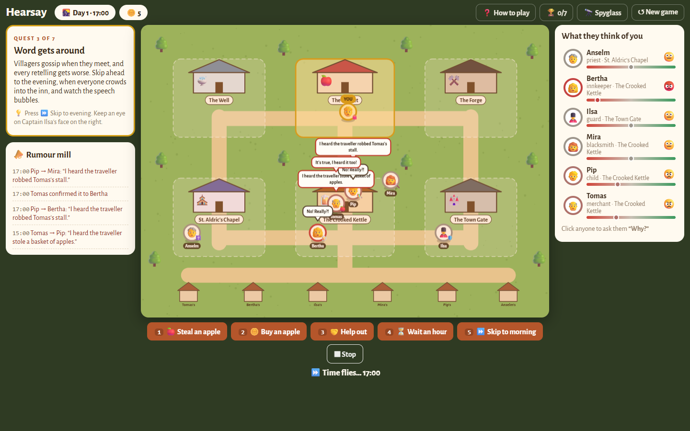
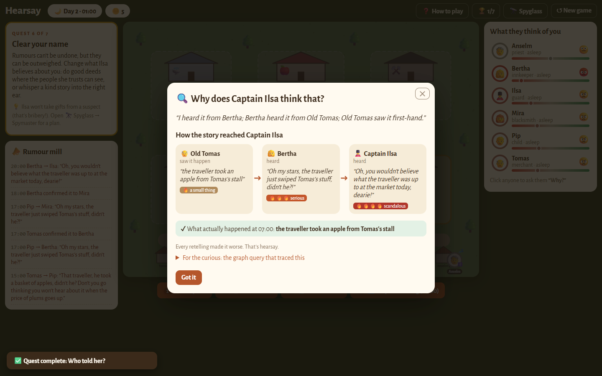
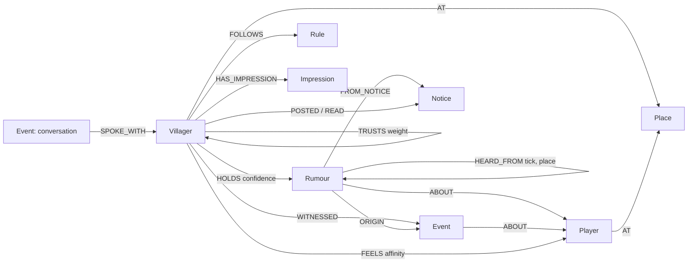

# Hearsay — *Everyone's talking about you.*

**NPCs that remember what you did, and gossip about it.** Hearsay is a small web game and an open-source memory engine. Every villager's memories, beliefs and relationships live in a [FalkorDB](https://www.falkordb.com/) graph. When you do something, the villagers who saw it remember it. When villagers meet, rumours travel along their trust relationships and get worse with every retelling. Villagers who never saw you act on what they've *heard*, and when you ask **"Why?"**, they show you exactly who told whom.

> Steal an apple. Only Old Tomas sees it. That evening at the inn, Tomas and Pip tell Bertha, and Bertha tells Captain Ilsa: *"took an apple"* → *"stole a basket"* → *"robbed the market"*. Next morning the guard, who never saw a thing, blocks the gate. Ask her why: *"I heard it from Bertha; Bertha heard it from Old Tomas; Old Tomas saw it first-hand."* The path lights up in the graph, with the Cypher query that found it.



## How to play
Walk around a tiny village (WASD, arrow keys, or click/tap). A 7-step quest teaches everything:
1. Arrive hungry with 5 coins and walk to the market. 2. Steal an apple (Old Tomas sees it).
3. Skip to the evening: watch the story spread at the inn in speech bubbles, getting worse each time.
4. Try to leave: the guard, who never saw a thing, blocks the gate. 5. Ask her **"Why?"** to see the exact chain of who told whom.
6. Clear your name by working the gossip network (gifts to a suspicious guard count as bribes). 7. Escape.
Then hunt 7 achievements. The 🔭 Spyglass shows the trust graph, PageRank, cliques, rumour routes and every Cypher query as it runs.



**Hackathon:** Graph Hacks: Context for AI Agents (WeMakeDevs × FalkorDB)
**Tracks:** Track 02 — **Agent Memory and Coordination** (primary) · Track 01 — **Agents That Act on Connected Data**

## Run it

### Docker (one command)
```bash
docker compose up --build
# open http://localhost:8000   (FalkorDB Browser: http://localhost:3000)
```
The app seeds the template village into FalkorDB on first start. With no `LLM_API_KEY`, villagers speak from templates built from the same graph facts. To turn on AI voices, copy `.env.example` to `.env` (gitignored) and set `LLM_API_KEY=<Google AI Studio key>`. Any OpenAI-compatible endpoint works. For fast local voices use Ollama (`ollama pull gemma3:4b`): set `LLM_BASE_URL=http://localhost:11434/v1` and `LLM_MODEL=gemma3:4b` for local dev, or `DOCKER_LLM_BASE_URL=http://host.docker.internal:11434/v1` and `DOCKER_LLM_MODEL=gemma3:4b` for Compose. Gemma 4 on AI Studio works but is slow (14–34 s per call), so retellings and impressions are reworded in the background.

### Local development
```bash
docker run -d --name falkordb -p 6379:6379 -p 3000:3000 falkordb/falkordb:latest
pip install -r backend/requirements.txt
cd backend && uvicorn app.main:app --reload          # API on :8000
cd frontend && npm install && npm run dev             # UI on :5173, proxies /api
python scripts/demo_scenario.py                       # the wow moment, printed hop by hop
python -m pytest backend/tests                        # 14 tests against a real FalkorDB
```

## Graph data model

One FalkorDB graph per player: `hearsay_<playerId>`, a `GRAPH.COPY` of the read-only `hearsay_template` village.



| Node | Key properties | Meaning |
|---|---|---|
| `Villager` | `id, name, role, gossip, exaggeration, persona, schedule` | An NPC agent |
| `Place` | `id, name` | One of 6 locations |
| `Player` | `id, name` | Anonymous player |
| `Event` | `id, kind, ladder, tick, juiciness, sentiment, base_text` | What actually happened (episodic memory) |
| `Rumour` | `id = event:holder, text, severity 1–5, sentiment, hops` | One villager's **version** of a story (semantic memory) |
| `Rule` | `condition, action, threshold` | Procedural memory, e.g. guard: `opinion_below −0.3 → block_gate` |
| `Notice` | `kind, text, tick` | Shared state one agent posts for others |
| `Impression` | `text, updated_tick` | Nightly one-line consolidation of a villager's view |
| `World` | `tick, seed` | The clock and the RNG seed |

| Relationship | Meaning |
|---|---|
| `(a)-[:TRUSTS {weight}]->(b)` | a believes what b says. Gossip flows **against** this arrow. |
| `(v)-[:HOLDS {confidence, since, last_reinforced}]->(r)` | v believes this version |
| `(r2)-[:HEARD_FROM {tick, place}]->(r1)` | provenance: r2 was told from r1. Two of these = corroborated |
| `(r)-[:ORIGIN]->(e)` | which real event the story is ultimately about |
| `(v)-[:CLOSE]->(b)` | derived at seed time: trust ≥ 0.6, used for cliques |

## The Cypher queries the product depends on

Every query is its own file in [`backend/queries/`](backend/queries), loaded by name and timed on every call (the in-game "Under the hood" tab shows each one and its ms). The key ones:

| Query | File | What it does |
|---|---|---|
| Q-WITNESS | [`witness.cypher`](backend/queries/witness.cypher) | Creates the event; every villager `AT` the place gets `WITNESSED` + a hop-0, severity-1 rumour. Nobody there → nobody knows. |
| Q-PAIRS | [`pairs.cypher`](backend/queries/pairs.cypher) | Co-located villagers where the listener trusts the teller. |
| Q-CANDIDATES | [`candidates.cypher`](backend/queries/candidates.cypher) | What A will tell B: skips what B saw first-hand, what B already heard from A, and anything whose chain came from B (echo-chamber guard, `NOT (r)-[:HEARD_FROM*1..6]->(mine)`). |
| Q-HOP | [`hop.cypher`](backend/queries/hop.cypher) | B's new version: `hops+1`, confidence × trust × 0.9, maybe one step worse on the distortion ladder. |
| Q-CORROBORATE | [`corroborate.cypher`](backend/queries/corroborate.cypher) | Second teller: another `HEARD_FROM`, confidence `1 − (1−c)(1−c')`. |
| Q-OPINION | [`opinion.cypher`](backend/queries/opinion.cypher) | Σ sentiment × confidence + direct feeling, with how many distinct tellers each rumour has (the sceptic needs 2). |
| **Q-WHY** | [`why.cypher`](backend/queries/why.cypher) | The provenance path: strongest belief, then `(r)-[:HEARD_FROM*0..6]->(o)` back to a first-hand witness or a notice. |
| Q-NOTICE-POST/READ | [`notice_post.cypher`](backend/queries/notice_post.cypher), [`notice_read.cypher`](backend/queries/notice_read.cypher) | The guard's wanted notice: a second, formal channel next to gossip. |
| Q-DECAY | [`decay.cypher`](backend/queries/decay.cypher) | Nightly forgetting for beliefs not reinforced in 24 hours. |

**Graph algorithms as agent tools** (the spymaster panel and the spymaster's advice):
| Query | Algorithm | Use |
|---|---|---|
| [`pagerank.cypher`](backend/queries/pagerank.cypher) | `algo.pageRank('Villager','TRUSTS')` | Whose word spreads furthest (Bertha) |
| [`communities.cypher`](backend/queries/communities.cypher) | `algo.WCC` over `CLOSE` | Cliques: the inn crowd, the chapel pair |
| [`broker.cypher`](backend/queries/broker.cypher) | `algo.betweenness` | Who connects the groups |
| [`route.cypher`](backend/queries/route.cypher) | `shortestPath((s)<-[:TRUSTS*1..6]-(t))` | Fastest way for a rumour to reach someone: Pip → Bertha → Ilsa |

FalkorDB-specific findings (syntax that differs from the docs or from Neo4j habits) are in [`DECISIONS.md`](DECISIONS.md).

## How it works

```
Browser (React + Vite + react-force-graph-2d)
  village map · dialogue + Why? · gossip graph · spymaster · under the hood
        │ X-Player header
FastAPI (Python 3.11)
  engine/gossip.py   tick: move → pairs → candidates → hop / corroborate → rules → nightly decay + impressions
  engine/memory.py   witness, opinion (rules applied), feelings, impressions
  agents/villager.py perceive (graph) → decide (code, from Rule nodes) → speak (AI, template fallback) → remember (graph)
  agents/spymaster.py PageRank / WCC / betweenness / shortest path → plan
  llm.py             one OpenAI-compatible client, cached retellings, template fallback
  db.py              one graph per player, queries loaded from backend/queries/*.cypher
        │
FalkorDB
```

- **The AI never decides.** Blocking the gate, raising prices and refusing a room come from `Rule` nodes evaluated in code against graph opinion. The model only phrases the decided action, using only the facts the graph returned.
- **Distortion is deterministic.** Each event kind has a 5-step severity ladder; each retelling moves up one step with the teller's `exaggeration` probability. The RNG is `Random(f"{seed}:{tick}")`, so the same seed and the same actions give the same spread.
- **Memory types.** Episodic: `Event`, `WITNESSED`, conversations. Semantic: `Rumour` + confidence, consolidated nightly into an `Impression`. Procedural: `Rule` nodes each villager `FOLLOWS`.
- **Coordination.** Informal: gossip hops along trust. Formal: when Ilsa's opinion drops below −0.6 she posts a `Notice`; anyone passing the gate reads it and believes a severity-3 version.
- **Per-player memory.** Each player has their own graph; `test_isolation` proves no leakage. Returning players arrive the next morning, after the village has caught up.

## Measurements
From [`docs/results.md`](docs/results.md), measured on a laptop:
- **500 player worlds alive in one FalkorDB instance**, 16 ticking in parallel: Q-BELIEFS/Q-OPINION p50 **1.1 ms**, p95 **2.3 ms**; flat from 10 to 500 worlds.
- `GET /api/why`: **7.7 ms** end to end (Q-WHY 2.4 ms).
- Over 50 seeds, the theft reached the guard every time, median **9 hours**, arriving at mean severity **2.5**.
- Grounding: **0 / 50** replies from the real model (Gemma 3 4B) named a villager outside the speaker's graph context.

## Data
All villagers, places and events are fictional and were written for this project. Players are random anonymous IDs. No personal or real-world data is used.

## AI assistance disclosure
Built with **Claude Code** (Anthropic): it turned the PRD into tasks ([`TASKS.md`](TASKS.md)) and wrote most of the backend, queries, tests and frontend, verifying every Cypher query against a live FalkorDB. In-game, villager voices, retellings, impressions and spymaster advice use **Gemma** (Gemma 3 4B on Ollama locally, Gemma 4 on Google AI Studio when hosted; templates if neither is available). *[Author: add which parts you wrote or reviewed yourself.]*

## Credits
FalkorDB and its Python client · FastAPI · React · Vite · react-force-graph · Gemma. MIT licence.
