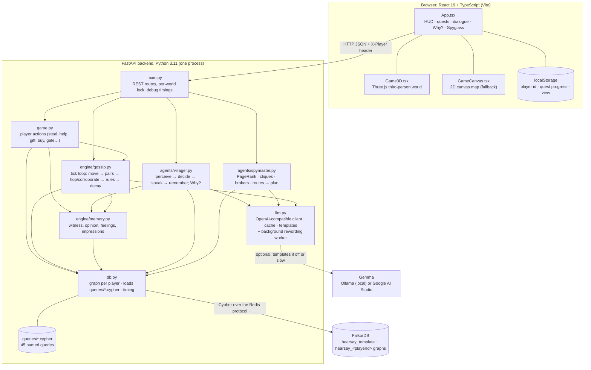
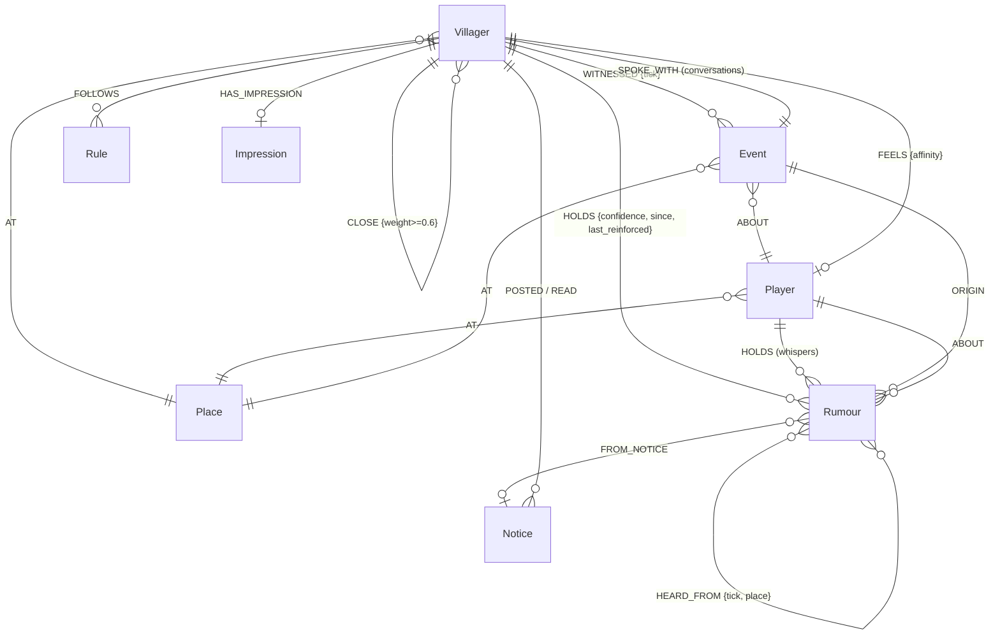
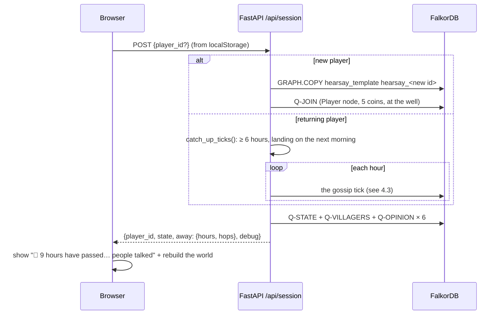
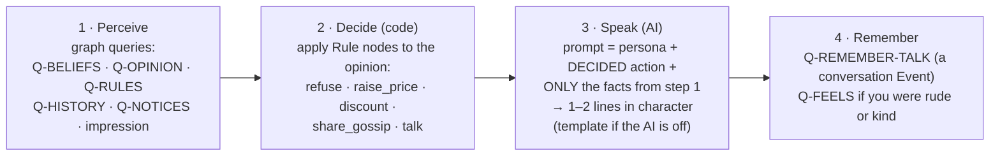

# Hearsay: architecture

This document explains **what Hearsay is, how the pieces fit together, and how each part is used**, from a click in the browser down to the Cypher query in FalkorDB. It is written so you can explain the system to a judge, an organiser or a game developer.

---

## 1. What Hearsay is

**Hearsay is a memory-and-gossip engine for game characters (NPCs), with a small game built on top to show it working.**

Most game characters forget everything, or share a single "reputation" number. In Hearsay, each character has their own **memories** (what they saw), **beliefs** (what they were told, by whom, and how sure they are) and **relationships** (whom they trust). Knowledge moves between characters **only through realistic channels**: they have to be in the same place, and the listener has to trust the teller. Stories **change** as they're retold. Characters **act** on what they believe, and every belief can be **traced** back to its source.

All of that state lives in a **FalkorDB graph**, because the questions the game asks are graph questions:
- "Who can tell whom right now?": a pattern match over location and trust.
- "How did the guard hear about this?": a variable-length path back to the original event.
- "Whose word spreads furthest?": PageRank.
- "What's the fastest way to get a story to the guard?": shortest path.

The language model never stores or decides anything. It only turns facts from the graph into in-character sentences.

### The game layer
A 3D third-person village (Three.js) with six villagers and six places, and a 7-step quest: steal an apple → watch the story spread and grow → get blocked at the gate by a guard who never saw it → ask "Why?" and see the chain → repair your reputation through the gossip network → escape. The same game also runs as a 2D map. Player guide: [HOW_TO_PLAY.md](HOW_TO_PLAY.md).

### Where the engine fits in real games
Open-world and story games already fake parts of this:
- Crime systems where **witnesses** report you, and towns that remember a bounty.
- **Honour / reputation meters** that change how shopkeepers and guards treat you.
- **Nemesis-style** enemies that remember your last encounter.

Hearsay is the general version of that idea: **per-character beliefs with provenance, spreading through a social graph.** In a GTA- or Witcher-style world it would let:
- a shopkeeper in another town raise prices because a cousin told them what you did, not because a global meter moved;
- a guard say *who* reported you;
- your reputation be repaired by **who you convince**, not by waiting for a timer;
- quest-givers react to exaggerated versions of your exploits ("I hear you slew a dragon single-handed…").

What exists today is a working prototype with 6 characters. Section 11 describes how it would plug into a game engine and what would need to change at open-world scale.

---

## 2. System overview



| Layer | Technology | Responsibility |
|---|---|---|
| **Presentation** | React 19, TypeScript, Three.js r169, react-force-graph-2d | Draws the world, HUD and panels; turns key presses and clicks into API calls; plays back gossip as speech bubbles. Holds **no game state** except quest progress (a UI concern) |
| **API** | FastAPI + Uvicorn | One HTTP endpoint per player intent. Validates input, picks the player's graph, holds a per-world lock, and returns timings for every query |
| **Game logic** | Plain Python modules | Rules of the game: actions, the gossip tick, opinion maths, agent behaviour. **Stateless**: every fact is read from and written to the graph |
| **AI** | Any OpenAI-compatible endpoint (Gemma 3 4B on Ollama, or Gemma 4 on AI Studio) | Phrases replies and retellings. Optional: every call has a template fallback |
| **Data** | FalkorDB (graph database, Cypher) | The single source of truth: villagers, places, events, rumours, trust, rules, notices, conversations. One graph per player |

---

## 3. The graph data model



| Node | Key properties | Memory type |
|---|---|---|
| `Villager` | `id, name, role, gossip, exaggeration, persona, schedule` | The agent |
| `Place` | `id, name` | — |
| `Player` | `id, name, coins` | — |
| `Event` | `id, kind, ladder, tick, juiciness, sentiment, base_text` | **Episodic**: what really happened; conversations are Events too |
| `Rumour` | `id = event:holder, text, severity 1–5, sentiment, hops` | **Semantic**: one villager's version of a story |
| `Rule` | `condition, action, threshold` | **Procedural**: e.g. guard `opinion_below −0.3 → block_gate` |
| `Notice` | `kind, text, tick` | **Shared state** one agent posts for others |
| `Impression` | `text, updated_tick` | **Consolidated** nightly summary |
| `World` | `tick, seed` | The clock and the random seed |

**Why one graph per player?** Each player has their own village and story. FalkorDB holds thousands of independent graphs in one instance, and a query on `hearsay_abc` can never touch `hearsay_xyz`, so **tenant isolation comes from the database**, not from `WHERE player = …` filters (`test_isolation` proves it). A new player gets a `GRAPH.COPY` of the read-only `hearsay_template`.

---

## 4. How a request flows

### 4.1 Starting or resuming a session



### 4.2 A player action (e.g. steal)

```mermaid
sequenceDiagram
  participant B as Browser
  participant A as FastAPI /api/act
  participant G as game.py / memory.py
  participant F as FalkorDB
  B->>A: POST {action: "steal"}  (X-Player: abc)
  A->>A: take the lock for hearsay_abc
  A->>G: act()
  G->>F: Q-WORLD (where am I, what time is it)
  G->>F: Q-WITNESS: create the Event; every Villager AT this place gets WITNESSED + a hop-0 Rumour
  F-->>G: witnesses = ["Old Tomas"]
  G->>G: advance(1 hour), the tick in 4.3
  A->>F: state (positions, opinions)
  A-->>B: {result: {witnesses, hops}, state, debug: [{name, ms}…]}
  B->>B: Tomas says "Oi! I saw that!", his face turns 😠, quest advances
```

### 4.3 The gossip tick (one in-game hour), `engine/gossip.py`

```
tick_once(world):
  1. Q-TICK           clock += 1; rng = Random(f"{seed}:{tick}")       # deterministic
  2. Q-MOVE           place every villager by their schedule (nobody at night)
  3. Q-PAIRS          (A)-[:AT]->(place)<-[:AT]-(B), (B)-[:TRUSTS]->(A): "A can tell B"
  4. for each pair, in shuffled order, if rng < A.gossip:
       Q-CANDIDATES   A's juiciest beliefs B hasn't got from A; skip if B saw it first-hand,
                      or if A's version came from B (echo-chamber guard)
       if B already has a version   → Q-CORROBORATE: add HEARD_FROM, c = 1-(1-c)(1-c_new)
       else                         → Q-HOP: B's new Rumour, hops+1,
                                       confidence = A.conf × trust(B→A) × 0.9,
                                       severity +1 with probability A.exaggeration
  5. rules            if the guard's opinion < -0.6 → Q-NOTICE-POST (wanted notice);
                      villagers at the gate → Q-NOTICE-READ → believe a severity-3 version
  6. at midnight      Q-DECAY (forget unreinforced beliefs ×0.97) + Q-IMPRESSION per villager
  return the list of hops (the browser animates them as speech bubbles)
```

The randomness is seeded by `(world seed, tick)`, so **the same actions always produce the same spread**. That makes the demo reliable and the tests exact (`test_determinism`).

### 4.4 Talking to a villager: the agent loop, `agents/villager.py`



The **decision is made by code from graph data**, so the model can't change what a character does, only how they say it. The prompt tells the model to use only the listed facts. `test_no_invented_knowledge` checks 50 conversations for names the speaker shouldn't know: **0 / 50**, with the real model too.

### 4.5 "Why?": provenance

`GET /api/why?villager=ilsa` runs Q-WHY: take Ilsa's strongest belief, follow `HEARD_FROM*0..6` back to a version with `hops = 0` (a witness) or one that came from a notice, then name the holder of every version on the path. The answer is built **from the path itself** (no AI), so it is exact and instant: *"I heard it from Bertha; Bertha heard it from Old Tomas; Old Tomas saw it first-hand."* The response also includes the Cypher text, which the UI shows.

### 4.6 Spymaster: graph algorithms as agent tools

`/api/spymaster/influence` runs `algo.pageRank`, `algo.WCC` and `algo.betweenness` inside FalkorDB. `/route` runs `shortestPath`. `/ask` combines them with opinions and schedules into a plan ("Ilsa trusts Bertha most; Bertha is at the inn from 10:00; do a good deed there"). The quest card shows that plan during the repair quest.

---

## 5. Where the AI is used, and where it isn't

| Use | AI? | Why |
|---|---|---|
| Villager replies in conversation | **Yes**, live, with a template fallback | The only place free-form language matters |
| Retelling wording ("Oh my stars, the traveller snatched Tomas's stuff!") | **Yes, in the background** | The tick writes template text instantly; one worker thread rewrites it with the model afterwards (`gossip.polish_later`). Ticks stay fast and deterministic |
| Spymaster plan wording | Yes, with a template fallback | Phrasing only; the plan comes from graph results |
| What happened, who knows what, opinions, decisions, severity, Why? chains, impressions | **No** | Code and graph queries only: traceable, testable, can't hallucinate |

Configuration is one OpenAI-compatible client (`LLM_BASE_URL`, `LLM_API_KEY`, `LLM_MODEL`). Local play uses **Ollama `gemma3:4b`** (~1–4 s per reply). Hosted play can use **Gemma 4 on Google AI Studio**: slower, and it always "thinks" first, so `llm.py` strips the `<thought>` block, gives it a thinking budget and retries 5xx errors. With `LLM_DISABLED=true` or no key, every feature still works with templates (`test_fallback`).

---

## 6. Concurrency, isolation and robustness

| Concern | How it's handled |
|---|---|
| Two players at once | Separate graphs; worlds tick independently. Load test: **500 worlds** alive in one FalkorDB, read p95 **2.3 ms** |
| Two tabs of the same player | A per-world lock around each request (a tick is ~20 writes that must not interleave) |
| New players arriving together | `GRAPH.COPY` forks the server and fails if two run at once ("could not fork"), so copies are serialised and retried |
| Slow model blocking the game | Retellings are reworded in the background through **one** worker queue; "Why?" and impressions never wait for the model |
| Slow database under load | Every query passes a 10 s timeout (FalkorDB's default is 1 s) |
| Bad input | The player id must match `^[a-z0-9]{6,32}$` (it becomes a graph name); text ≤ 300 chars; actions validated server-side (you can't steal outside the market or talk to someone who isn't there) |
| Secrets | `.env` is gitignored; `.env.example` has blanks |

---

## 7. Frontend architecture

- **`App.tsx`** owns the UI state: the latest `state` from the server, quest progress, bubbles, toasts, modals. Every gameplay change goes through the API; the browser never simulates gossip itself.
- **`Game3D.tsx`** (Three.js) and **`GameCanvas.tsx`** (2D canvas) implement the **same props** (`state`, `bubbles`, `onZone`, `onNear`, `onTalk`), so they are interchangeable. 3D is the default; 2D is a toggle and the fallback when WebGL is missing.
  - The world is built from primitives in code (no downloaded assets).
  - Villagers walk towards the positions the server reports.
  - Walking into a place calls `POST /api/act {go}`.
  - Names, bubbles and prompts are a DOM overlay projected from 3D positions.
  - Buildings are solid and fade when they block the camera.
  - The sky and windows follow the in-game hour.
- **`quests.ts`** holds the 7 quests and 7 achievements as small `done(state, flags)` checks over server state. Progress is saved per player in `localStorage` (it's a UI tutorial, not world state).
- **`Spyglass.tsx`** hosts the trust network (`GossipGraph.tsx`, react-force-graph-2d), `Spymaster.tsx` and `Inspector.tsx` (live query timings and Cypher, from the `debug` block every response carries).
- In production the backend serves the built frontend from `frontend/dist`, so it's **one container**.

---

## 8. API reference

| Method & path | Body / params | Returns |
|---|---|---|
| `POST /api/session` | `{player_id?}` | New world (template copy) or resumed world after catch-up; `away` summary |
| `GET /api/state` | — | Clock, coins, positions, opinions, notices |
| `POST /api/act` | `{action: go\|steal\|help\|gift\|whisper\|buy\|pass_gate\|wait, place?, target?, ladder?}` | Result (witnesses, price, blocked, refused…), the hops that happened, new state |
| `POST /api/talk` | `{villager, text}` | Reply, decided action, opinion, beliefs |
| `GET /api/why` | `?villager=` | Chain of holders and versions, what really happened, the Cypher |
| `POST /api/wait` | `{ticks}` | Hops + new state |
| `GET /api/spymaster/influence` | — | PageRank, communities, brokers |
| `GET /api/spymaster/route` | `?start=&target=` | Shortest gossip route |
| `POST /api/spymaster/ask` | `{question}` | Plan + the data used |
| `GET /api/graph` | `?view=trust\|rumour` | Trust edges, or every version of every story |
| `POST /api/reset` | — | Fresh village |
| `GET /api/queries` | — | All Cypher query texts (for the inspector) |
| `GET /api/health` | — | DB and AI status |

Every response carries `debug.queries: [{name, ms}]`.

---

## 9. Repository map

```
backend/
  app/main.py            routes, locks, state assembly, serves frontend/dist
  app/db.py              FalkorDB client, graph per player, query loader + timing, template copy
  app/game.py            player actions, prices, the gate check, coins
  app/llm.py             model client, thought-stripping, retries, cache, fallbacks
  app/engine/gossip.py   the tick loop + background rewording worker
  app/engine/memory.py   witness, whisper, opinion (+ rules), feelings, impressions, ladders
  app/agents/villager.py perceive/decide/speak/remember, Why?
  app/agents/spymaster.py influence, routes, plan
  queries/*.cypher       45 named queries (the README lists the key ones)
  seed/village.json      places, villagers, schedules, trust, rules, ladders (edit this to make a new village)
  seed/seed.py           builds hearsay_template
  tests/                 15 tests against a real FalkorDB
frontend/src/            App, Game3D, GameCanvas, Dialogue, WhyModal, Spyglass (+ GossipGraph, Spymaster, Inspector), quests, world, api
scripts/                 demo_scenario.py · load_test.py · grounding_check.py
docs/                    this file, HOW_TO_PLAY.md, READING_THE_GRAPH.md, results.md, screenshots
```

---

## 10. Deployment

- **Local:** `docker compose up --build` starts FalkorDB and the app (`:8000`, FalkorDB Browser on `:3000`). On first start the app seeds `hearsay_template`.
- **Hosted:** one container (the `Dockerfile` builds the frontend, then runs Uvicorn and serves both) plus a managed FalkorDB (`FALKORDB_HOST/PORT/USERNAME/PASSWORD`). AI via `LLM_*` variables, or none.

---

## 11. Using the engine in another game

Hearsay's contract with a game is small:

| Game → engine | Engine → game |
|---|---|
| "**Event** happened at **place**, involving **subject**" (theft, rescue, insult…) | "**NPC** now believes **story** about **subject**, at **confidence**, because **X told them**" |
| "**NPCs** are now at these places" (or let schedules drive it) | "**NPC**'s opinion of **subject** is −0.5, so rule `block_gate` fires" |
| "Advance time by N" | "Explain why **NPC** thinks this": the path, ready for dialogue |

A game engine (Unity, Unreal, Godot) would call these as HTTP endpoints or link the queries directly. To adapt it:
- **Content** is data, not code: `village.json` holds characters, schedules, trust, rules and the severity ladder per event type (theft, murder, heroism…).
- **Behaviour** comes from `Rule` nodes, so designers can add "merchant refuses service below −0.5" without code.
- **Voice** comes from any language model, or none (the templates).

**At open-world scale** (GTA, The Witcher), the same model applies, with these engineering steps the prototype doesn't need yet:
1. **Simulate gossip only where it matters**: full ticks for characters near the player or story-relevant, coarse rules for the rest (gossip level of detail).
2. **Partition** the world: one graph per region or settlement, with travelling characters carrying beliefs between graphs.
3. **Batch** ticks: each tick's pairs and hops as a few large `UNWIND` queries instead of one query per pair.
4. **Prune** memory: the nightly decay already fades beliefs; at scale, faded Rumours would be archived.

The prototype's measurements (`docs/results.md`): Q-BELIEFS + Q-OPINION at **~1 ms p50 / 2.3 ms p95** with 500 worlds, and a full tick in ~15 ms. Those numbers are why per-character, per-turn graph reasoning is affordable.

---

## 12. Glossary

| Term | Meaning here |
|---|---|
| **Tick** | One in-game hour: the moment villagers move and gossip |
| **Hop** | One retelling: a new Rumour for the listener, linked to the teller's version |
| **Corroboration** | Hearing the same story from a second person: a second `HEARD_FROM`, higher confidence |
| **Severity / distortion ladder** | 1–5 steps a story can climb when retold ("took an apple" → "part of a gang of thieves") |
| **Confidence** | How sure a villager is (0–1); drops with every hop, rises with corroboration, fades with time |
| **Provenance** | The chain of who told whom: the `HEARD_FROM` path |
| **Echo-chamber guard** | A story isn't told back to the person it came from, so confidence can't loop |
| **Opinion** | One number per villager per player, from beliefs and feelings, that drives behaviour |
| **Procedural memory** | `Rule` nodes: what a role does at what opinion |
| **Template** | The read-only starting village graph that new players copy |
